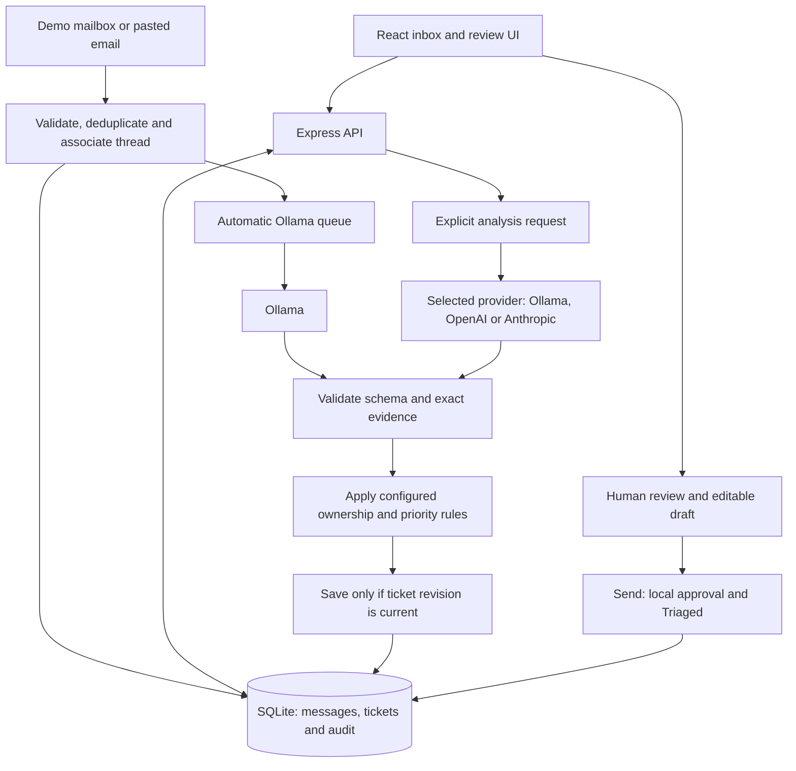

# Relay — AEM Support Triage & Routing Copilot

Relay helps a support coordinator turn an incoming email into a classification, an ownership recommendation and a reviewed handover draft. **Ollama analyzes incoming demo emails automatically**, while the coordinator confirms the decision and edits the draft. OpenAI and Anthropic are available for explicit re-analysis.

This is a local prototype. The inbox contains fictional emails. **The Send button completes local triage; it does not deliver an email.** Relay does not connect to a real mailbox or change AEM.

## Contents

- [Start the application](#start-the-application)
- [Try the workflow](#try-the-workflow)
- [Configure models and customer routing](#configure-models-and-customer-routing)
- [Customer context, value and assumptions](#customer-context-value-and-assumptions)
- [Architecture overview](#architecture-overview)
- [Reliability and failure handling](#reliability-and-failure-handling)
- [Logs and troubleshooting](#logs-and-troubleshooting)
- [Tests and evaluation](#tests-and-evaluation)
- [Trade-offs and scalability](#trade-offs-and-scalability)
- [Known limitations](#known-limitations)
- [Use of AI and further reading](#use-of-ai-and-further-reading)

## Start the application

### Recommended: one command

Clone the repository, open a terminal in its root directory, and run:

```sh
bash scripts/demo.sh
```

Each run starts a fresh demo mailbox in a new timestamped database, with the initial emails in **New** and Ollama analysis queued. Previous session databases stay saved.

When setup finishes, open **[http://localhost:3003](http://localhost:3003)**. On macOS, the script opens your browser automatically. Keep the terminal running; press **Ctrl+C** to stop the application.

The script performs these steps:

1. Reuses a compatible Node.js installation, or downloads Node.js 24 LTS locally and verifies its archive checksum.
2. Creates `.env` from `.env.example` if it does not exist and selects a fresh `.runtime/demo-YYYYMMDD-HHMMSS-<unique-id>.sqlite` database for this session.
3. Installs locked application dependencies with `npm ci`.
4. Runs application tests, bootstrap checks and the frontend/backend build.
5. Reuses Ollama, or downloads it locally; starts it if needed and checks the first model in `OLLAMA_MODELS` (default: `qwen2.5:7b`). An installed model is reused without contacting the download registry; a missing model is pulled.
6. Starts the compiled application and checks that it is reachable.

**Prerequisites:** macOS or Linux/WSL on x64 or ARM64, Bash, internet access for initial downloads, `curl`, `tar`, and `shasum` or `sha256sum` if Node must be downloaded. Installing Ollama on macOS requires macOS 14+ and `unzip`; on Linux, GNU tar with `zstd` is required. GPU drivers must already be installed. Native Windows users should use WSL for this script.

Allow several GB of free disk space and time for the first model download. Missing tools are installed under `.runtime/tools`, without an administrator password or writes to `/Applications`. Model files normally live in `~/.ollama`. The script does not install system packages, GPU drivers or cloud credentials. Company device policies may prevent downloads or execution.

| Option                               | Use it when…                                                        |
| ------------------------------------ | ------------------------------------------------------------------- |
| `bash scripts/demo.sh --no-open`     | You want to open the browser yourself.                              |
| `bash scripts/demo.sh --skip-ollama` | You will manage Ollama yourself or use a configured cloud provider. |
| `bash scripts/demo.sh --help`        | You want to see the available options.                              |

`--skip-ollama` still installs dependencies, tests, builds and starts Relay. It does not provide simulated AI responses; automatic Ollama analysis will fail if no local model is available.

Rerunning the command preserves `.env`, model files and previous session databases, while starting a new inbox by default. Existing tool installations are reused, not upgraded. Installed models are also reused; pull a model manually if you deliberately want to update it. Ctrl+C also stops an Ollama process started by the script, but leaves a pre-existing Ollama service running. If port 3003 is occupied, stop the existing server or change `PORT` in `.env` before rerunning.

### Manual setup and development

Use this path if Node.js **22.13+** and npm are already available. Run commands from the repository root:

```sh
npm ci
# Skip this copy if you already have an .env file.
cp .env.example .env
npm run dev
```

The API and development UI share one server at `http://localhost:3003`. Prepare Ollama separately as described below, or configure a cloud provider. Node's built-in SQLite may print an experimental warning.

To build and run the compiled application:

```sh
npm run build
npm start
```

After backend or `.env` changes, restart the server. When using the compiled application, rebuild before restarting. If the bootstrap downloaded Node locally, use `bash scripts/demo.sh` to restart, or add its runtime to your current terminal before running npm commands:

```sh
export PATH="$PWD/.runtime/tools/node/bin:$PATH"
```

## Try the workflow

1. **Read a ticket.** The inbox starts with ten fictional email threads. Try **Old banner on German homepage** or **Registration fails on iPhone Safari**.
2. **Inspect the analysis.** Ollama queues initial unfinished tickets at startup and new messages when ingested. Automatic analysis leaves tickets in **New**; an **Ollama** badge identifies a current local analysis. Opening an unfinished email can also queue analysis.
3. **Review the recommendation.** Inspect the quoted evidence, suspected category, routing explanation and missing information. In **Review**, confirm the program, team, impact, priority and next step, then save your decision with a note and acknowledgment.
4. **Complete the draft.** Open **Email draft**, check the recipient, edit and save any changes, then acknowledge and click **Send**. The ticket moves automatically to **Triaged**, the draft becomes read-only and its action controls disappear. No email is transmitted; Triaged does not mean delivery or incident resolution.
5. **Try a new arrival or reply.** Use the mailbox controls and **Refresh mailbox** to ingest another example. A new reply reopens its ticket as **New** and invalidates the old review/draft; the updated conversation is eligible for automatic analysis.

To compare providers, choose OpenAI or Anthropic and click **Analyze again** after configuring credentials and acknowledging cloud transfer. Re-analysis can replace saved review/draft work, so the UI asks for confirmation. Cloud providers never run automatically. The analyze button remains clickable and explains missing configuration or other failures.

### Demo mailbox controls

| Control                       | What happens                                                                |
| ----------------------------- | --------------------------------------------------------------------------- |
| **Receive next demo email**   | Makes the next of five remaining examples available for ingestion.          |
| **Receive Safari reply**      | Adds one reply to the existing Safari thread. Repeating it is deduplicated. |
| **Replay duplicate messages** | Replays two known message IDs; receipts appear in **Duplicates** and Logs.  |
| **Simulate mailbox outage**   | Makes synchronization fail while preserving saved tickets and the cursor.   |

The inbox view polls every three seconds, but demo message ingestion still requires mailbox refresh. Duplicate receipts link to the original ticket without changing its workflow or triggering another analysis.

### Start fresh or resume a session

`bash scripts/demo.sh` automatically selects a new database for each session. Its path is printed in the terminal; saved sessions are not deleted. A unique suffix prevents two starts in the same second from selecting the same file.

To resume an earlier session, explicitly supply the saved path:

```sh
DATABASE_PATH=".runtime/demo-YOUR-SAVED-SESSION.sqlite" bash scripts/demo.sh
```

You can also supply your own timestamped path:

```sh
DATABASE_PATH=".runtime/demo-$(date +%Y%m%d-%H%M%S).sqlite" bash scripts/demo.sh
```

An explicit terminal `DATABASE_PATH` takes precedence. For demo startup, the database path in `.env` is overridden by the fresh-session default; `npm run dev` and `npm start` continue using `.env` normally. Stop the current server before starting another session on the same port.

## Configure models and customer routing

Edit `.env` in the repository root, then restart Relay. API keys stay on the server. `.env` and `.runtime` are Git-ignored. Variables already exported in your terminal take precedence over `.env`.

| Setting                                 | Purpose / default                                                                                     |
| --------------------------------------- | ----------------------------------------------------------------------------------------------------- |
| `PORT`                                  | Application port: `3003`.                                                                             |
| `DATABASE_PATH`                         | Persistent file for manual startup: `.runtime/relay.sqlite`; demo startup selects a new session file. |
| `OLLAMA_HOST`                           | Local endpoint: `http://127.0.0.1:11434`; only loopback origins are accepted.                         |
| `OLLAMA_MODELS`                         | Comma-separated allowed models: `qwen2.5:7b`. The first is used automatically.                        |
| `OPENAI_API_KEY`, `OPENAI_MODELS`       | Optional cloud key and allowed models; default model: `gpt-4.1-mini`.                                 |
| `ANTHROPIC_API_KEY`, `ANTHROPIC_MODELS` | Optional cloud key and allowed models; default: `claude-sonnet-4-5-20250929`.                         |
| `MODEL_TIMEOUT_MS`                      | Analysis deadline, including a possible malformed-JSON retry: `60000` ms.                             |
| `MODEL_PRICES_JSON`                     | Optional operator-supplied USD prices per million tokens; empty by default.                           |

Model lists control the available choices; they do not grant provider access. Choose models that support the adapter's structured-output format and are available to your installation/account.

### Ollama

The recommended bootstrap prepares Ollama for you. For manual setup, install Ollama, start its service and pull the configured model:

```sh
ollama pull qwen2.5:7b
```

If the service is not running, start `ollama serve` in another terminal. A bootstrap-installed Ollama binary is local to the repository and may not be available as `ollama` in your normal terminal; rerunning the bootstrap is the simplest way to prepare it.

### OpenAI and Anthropic

Set the appropriate key and model list in `.env`, restart, select the provider in the UI and acknowledge cloud transfer. OpenAI uses the Responses API with strict JSON schema and `store: false`; Anthropic uses Messages structured outputs. Unsupported formats, unavailable models and account errors are reported explicitly. There is no automatic provider fallback.

Cloud requests include the subject, body, affected URL and conversation history. Sender addresses and attachment metadata are excluded from the structured prompt, but personal data within email text is **not automatically redacted**. Use fictional or appropriately sanitized content. Provider processing/retention depends on your account; `store: false` is not a universal zero-retention guarantee.

### Customer-owned routing

| File                                                   | What you can change                                                                       |
| ------------------------------------------------------ | ----------------------------------------------------------------------------------------- |
| [config/programs.json](config/programs.json)           | Exact website hosts, programs, affiliates and environments.                               |
| [config/teams.json](config/teams.json)                 | Team names and handover recipient addresses.                                              |
| [config/routing-rules.json](config/routing-rules.json) | Category/program ownership rules and candidate teams.                                     |
| [config/rate-card.json](config/rate-card.json)         | Illustrative, unapproved rates used by a tested helper; no estimator workflow is exposed. |

Restart after configuration changes. Demo addresses use `example.com`. The model cannot invent recipient addresses or approve financial commitments.

## Customer context, value and assumptions

**Assumed customer:** a global enterprise with Corporate, HCP, Patient and Campaign AEM Cloud Service portfolios, several development partners, and a central support coordinator handling roughly 30 emails per working day. Affiliates already use a shared mailbox; the coordinator needs help interpreting requests and identifying the right owner. Specialist engineers still diagnose and resolve issues.

**Expected value:** less time looking up ownership, fewer reassignment loops, clearer clarification questions and more consistent handovers. As an illustrative hypothesis, reducing triage from 12 to 5 minutes across 660 monthly tickets would save 77 hours/month. This has not been measured; a paired manual/assisted pilot should measure review time, routing correctness and reassignment rate.

The prototype assumes:

- A coordinator reviews every final decision; AI recommendations are provisional.
- The customer supplies and maintains authoritative domain, team and routing configuration.
- English, plain-text synthetic conversations are enough to demonstrate the workflow.
- One local user and one application process are sufficient for the assignment.
- Real mailbox delivery, AEM access and specialist diagnosis are outside this slice.

All people, domains, teams and emails supplied with the repository are fictional.

## Architecture overview



**Stack:** React + TypeScript + Vite for the UI; Express + Zod for the API; native HTTP provider adapters; Node SQLite for persistence. One Node process serves both the UI and API on `127.0.0.1`.

The model proposes classifications, summaries, impact, possible causes, investigation steps and missing information. It has no tools and cannot fetch URLs, inspect AEM, send mail or execute its suggestions. The API validates its output, resolves exact domains against customer configuration and applies routing rules. Unknown/conflicting ownership requires human confirmation; suspected security issues receive a minimum high priority and an escalation flag.

**Design note:** keeping interpretation separate from operational authority makes a model mistake reviewable. An exact quotation proves that text appeared in the email, but does not prove the model interpreted it correctly. Reviewed values remain separate from the AI recommendation.

Source layout: `src/web/` contains components and workflow hooks; `src/server/` contains ingestion, persistence, analysis and provider adapters; `src/shared/` contains types and validation; `config/`, `data/`, `tests/` and `evaluation/` hold customer rules, examples and verification assets.

## Reliability and failure handling

| Failure                                                 | How Relay handles it                                                                                                                |
| ------------------------------------------------------- | ----------------------------------------------------------------------------------------------------------------------------------- |
| Ollama unavailable, missing cloud key or provider error | Shows an explicit error; preserves saved work and allows manual review. No silent fallback.                                         |
| Malformed model JSON                                    | Allows one retry within the original deadline. Schema/evidence errors and refusals do not trigger repair loops.                     |
| Invented or altered evidence                            | Rejects output whose references are not exact source quotations. Human review still checks interpretation.                          |
| New reply or stale editor                               | Revision checks reject outdated writes/results. Replies invalidate review and draft approval.                                       |
| Duplicate delivery or interrupted sync                  | Provider/message IDs deduplicate ingestion; transactional storage precedes cursor advancement.                                      |
| Too many analyses                                       | Limits work to two concurrent analyses and one per ticket; excess manual requests receive 429. Automatic work has one queue worker. |
| Timeout or cancellation                                 | Stops local work where possible and preserves prior results. Provider cancellation/billing is best effort.                          |
| Restart                                                 | SQLite preserves messages, decisions, drafts, cursor and audit. Unfinished eligible tickets are queued again at startup.            |

The automatic queue and its statuses live in memory; they are not durable distributed jobs. Saved reviews/drafts and current analyses are reused rather than automatically overwritten. Failed automatic jobs are not repeatedly retried in the same process; opening a failed ticket permits another attempt.

Bounds include 64 KB API bodies, 50-message batches, 30-message threads, 30,000 subject/body characters for analysis, and 5,000 stored tickets. Oversized conversations require manual handling or a future explicit context-selection policy.

## Logs and troubleshooting

Click **Logs** in the top-right header for events across all tickets, or **Activity** inside a ticket for its own history. Search by ticket ID, request ID, analysis ID, event, model or error code; filter by severity and expand raw diagnostic details.

- **Request ID:** paste an error's request reference into Logs search, or search the terminal's JSON output to trace that API request.
- **Analysis ID:** search it in Logs to connect events belonging to the same analysis attempt.
- **Download all logs:** exports all persisted ticket events as JSON, irrespective of the current search, filters or page. Terminal-only HTTP/server logs are not included.

Latest logs refresh every five seconds; browsing older pages pauses automatic refresh. Diagnostic logs omit raw email text, reviewer notes, attachment content and credentials. The SQLite database itself still contains email text and review data.

Provider indicators refresh every 30 seconds; hover or focus for details. Ollama readiness checks reachability and installation of the first configured model, not inference quality. Cloud indicators only show whether a key is configured; they do not verify credentials, billing or model access. The Mailbox indicator represents the demo interface, not a live connector.

| Symptom                                 | What to do                                                                                                                                                                                                            |
| --------------------------------------- | --------------------------------------------------------------------------------------------------------------------------------------------------------------------------------------------------------------------- |
| Port already occupied                   | Stop the existing server or change `PORT`, then restart.                                                                                                                                                              |
| Ollama missing/offline or model missing | Rerun `bash scripts/demo.sh`, or start your own service and pull the configured model. Bootstrap service diagnostics are in `.runtime/ollama-demo.log`.                                                               |
| Model pull fails with upstream 503      | The download connection failed. Installed models are reused without a pull. If the model is missing, retry later and check network/proxy access; `--skip-ollama` starts Relay but does not install the missing model. |
| Cloud analysis fails                    | Check the key, allowed model, account access and cloud acknowledgment; restart after `.env` edits. Check inherited terminal variables too.                                                                            |
| Analysis times out                      | Check local resource usage and model size; consider adjusting `MODEL_TIMEOUT_MS` within the supported 100–300000 ms range.                                                                                            |
| Stale revision / 409                    | Reload the ticket and review the latest conversation before saving again.                                                                                                                                             |
| `API route not found` after an update   | Rebuild and restart the backend, then refresh the browser.                                                                                                                                                            |

`/api/health` reports runtime/configuration state without inference. `/api/metrics` exposes process-lifetime counters and P50/P95 durations for the last 100 successful analyses. Metrics reset on restart and omit failed-analysis durations from those percentiles; they are not a complete performance benchmark.

## Tests and evaluation

Run the checks independently of bootstrap:

```sh
npm test
npm run test:setup
npm run build
```

Tests cover persistence and rollback, deduplication/replies, stale revisions, routing and priority rules, provider parsing, consent, invalid output/evidence, timeouts/cancellation, concurrency, automatic analysis, draft completion and activity logs. Provider responses are mocked inside tests, so these checks need no live inference or cloud keys. The build also checks TypeScript.

For optional real-model verification:

```sh
npm run smoke -- ollama --live
npm run evaluate -- ollama --live
```

Replace `ollama` with `openai` or `anthropic` when configured. Every live run requires explicit `--live`; cloud runs transmit fictional conversations and may incur charges. `EVAL_MODEL`, if set, must be allowlisted.

Evaluation uses 20 labeled synthetic conversations and saves outputs in Git-ignored `evaluation/results/`. It measures type/category, configured program/owner and schema/evidence checks separately. These examples do not establish customer accuracy or handover usefulness. See [evaluation and pilot methodology](docs/evaluation.md).

## Trade-offs and scalability

| Choice                                                     | Benefit                                                               | Cost or compromise                                                                 |
| ---------------------------------------------------------- | --------------------------------------------------------------------- | ---------------------------------------------------------------------------------- |
| Local Ollama by default                                    | No cloud key needed; local inference avoids external prompt transfer. | Model downloads, hardware requirements and variable speed/quality.                 |
| Optional cloud providers                                   | Allows comparison with hosted models.                                 | Transfer consent, account dependencies and usage charges.                          |
| One structured analysis, then configured routing/templates | Fewer serial model calls and clear ownership authority.               | Interpretation can still be wrong; configuration must remain accurate.             |
| Human review before completion                             | Corrections remain explicit and auditable.                            | Review time remains part of total workflow latency.                                |
| Single process and SQLite                                  | Simple setup and a coherent end-to-end demo.                          | Synchronous database work, process-local locks and limited horizontal scalability. |

No live-model latency target, customer accuracy figure or savings claim has been demonstrated. Measure cold/warm model latency, queue wait, end-to-end P50/P95, failures/retries, review time and routing overrides under increasing load. Likely bottlenecks are model loading/inference, human review and the unpaginated inbox response.

Cost is shown only when provider usage and operator-supplied pricing are available. Retry cost may be unknown because discarded-attempt usage is unavailable. Local hardware/electricity costs are not calculated; larger models do not guarantee better decisions.

A future multi-instance deployment would need durable jobs, shared concurrency controls, a shared database, pagination and authenticated tenant boundaries. An Ollama replica pool could route work to healthy nodes and rebuild context from durable ticket data, with revision-safe result commits. **That cluster/failover design is not implemented**; the current endpoint is loopback-only. An interrupted generation would normally restart rather than continue seamlessly.

## Known limitations

- **Simulated mailbox and local completion:** no OAuth/webhooks, SMTP delivery, AEM/Cloud Manager/Jira/ServiceNow integration, live diagnosis or resolution tracking.
- **Single-user prototype:** no authentication, roles, tenant isolation or production deployment. Loopback/origin checks and plain-text rendering reduce local exposure but are not an enterprise security boundary.
- **Limited input handling:** no attachment extraction, general MIME/thread parsing, established multilingual support or automatic personal-data redaction. Exact IDs detect duplicates; similar email text does not.
- **Provisional AI interpretation:** quotations do not establish causality, confidence is not calibrated, and prompt-injection resistance is not proven. Incidental URLs may confuse domain interpretation; review remains necessary.
- **Local storage and history:** SQLite is not encrypted; no retention/archive/delete UI or full immutable archive of previous analyses and edited drafts. Protect the database, WAL/SHM files and backups; custom paths need their own permissions and Git exclusions.
- **Basic observability:** queued jobs and all HTTP events are not a durable ticket event stream. Log exports load records into memory. Historical failures that were only printed to a terminal cannot be reconstructed.
- **Deferred business scope:** no SLA management, knowledge retrieval/retraining, automatic escalation, or complete change-request approval/estimate workflow.

## Use of AI and further reading

Codex assisted with implementation, prompts, fictional examples/configuration, tests and documentation. React/Node tooling and native-provider parsing were reused from earlier local prototypes. Ownership lookup, recipients, routing rules, uniqueness, revision checks, review gates and financial calculations deliberately use deterministic code rather than model judgment.

Automated checks and browser walkthroughs were used to review core behavior. No production diagnosis or live cloud accuracy benchmark is claimed. Anyone submitting the repository should inspect the code and be ready to explain assumptions, safeguards and AI assistance.

Further detail: [assignment fit and scope](docs/concept-fit.md), [architecture and invariants](docs/architecture.md), [evaluation](docs/evaluation.md), and [frontend structure](src/web/README.md).

The assignment submission should be a remote Git repository link. Publishing is separate from local setup; no remote repository is created by the bootstrap. Keep `.env`, runtime data, keys and real customer emails out of Git.
